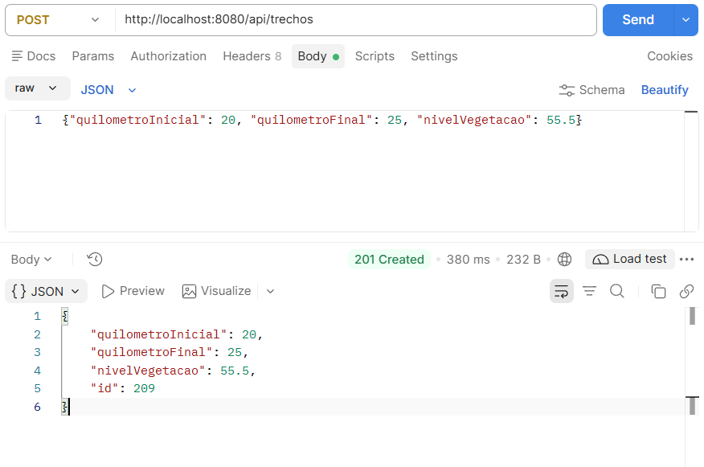
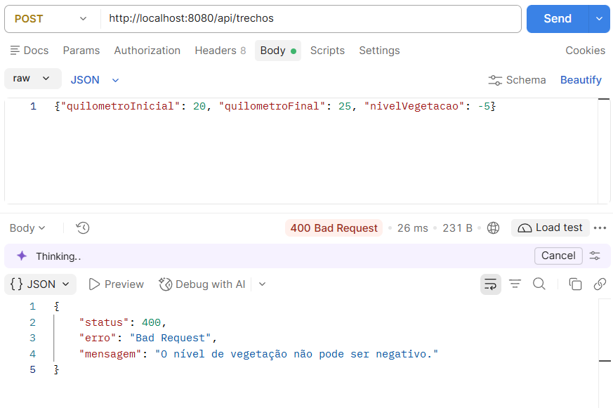
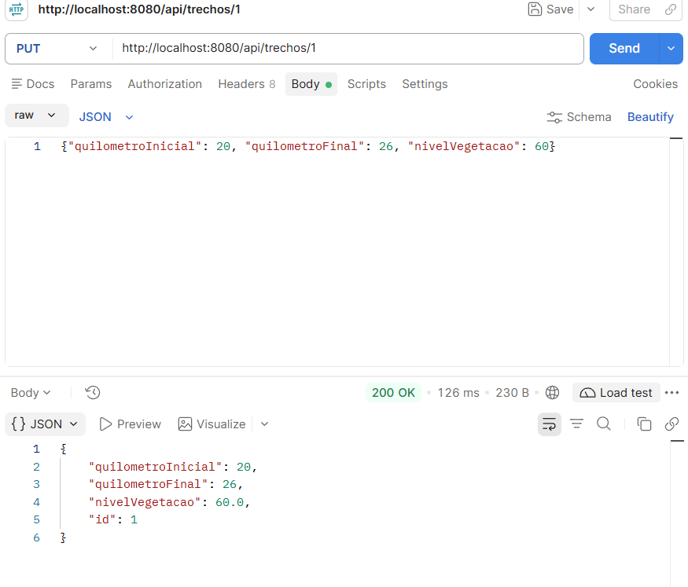
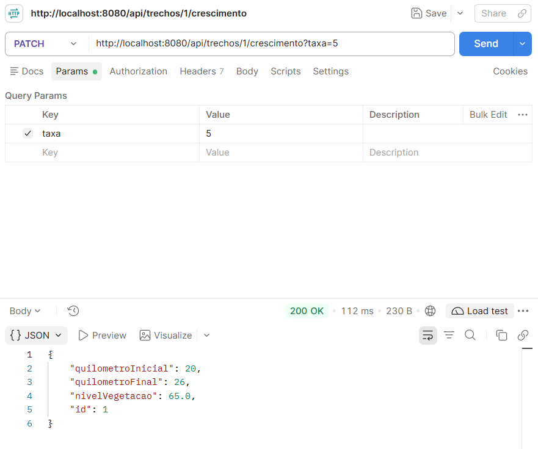
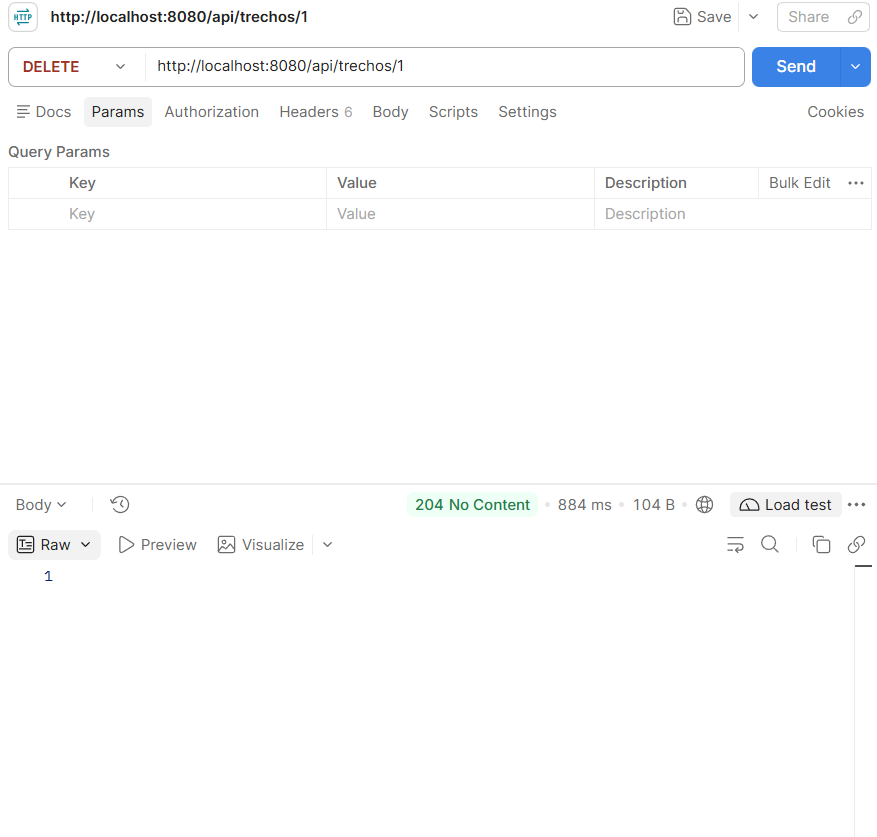
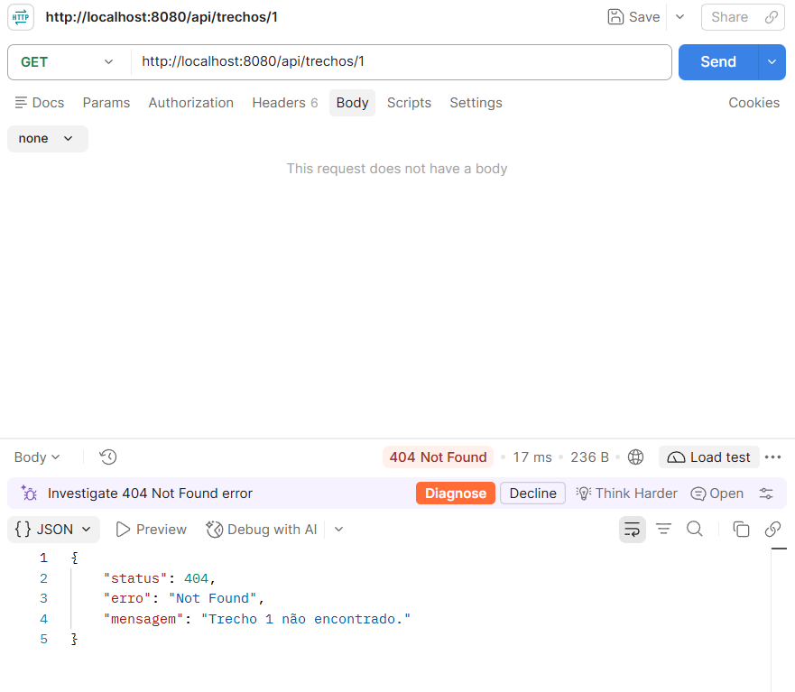
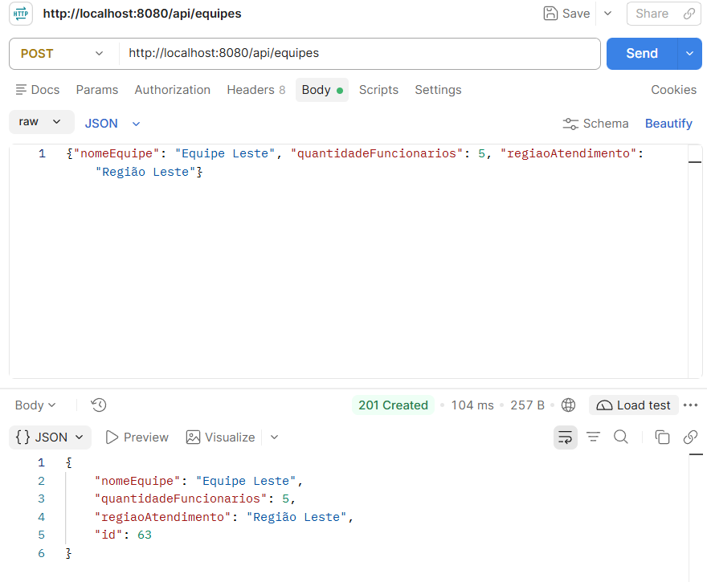

# MOTIVA - API REST (Sprint 4)

API REST do sistema **MOTIVA** para monitoramento de vegetação em rodovias e priorização de intervenções.
Nesta sprint, o protótipo de console com JDBC puro (Sprint 3) foi migrado para **Spring Boot + Spring Data JPA**,
reaproveitando o banco Oracle da FIAP e as tabelas modeladas na Sprint 3.

**Disciplina:** Object-Oriented Programming - FIAP

**Integrantes:**

| Nome | RM |
|---|---|
| Bruno Otávio da Cruz Carvalho | 562354 |
| Gustavo Cordeiro Braga | 562247 |
| João Vitor Santana Silva Ribeiro | 564693 |
| Letícia Gabrielle Andrade Temóteo | 563985 |
| Stefanny Brum dos Santos | 566216 |

---

## Tecnologias

| Item | Versão / detalhe |
|---|---|
| Java | 17 ou superior |
| Spring Boot | 4.1.0 (`spring-boot-starter-web` + `spring-boot-starter-data-jpa`) |
| Build | Maven (`pom.xml`) |
| Banco | Oracle FIAP (`oracle.fiap.com.br:1521:ORCL`) |
| Driver | `com.oracle.database.jdbc:ojdbc17` (dependência Maven) |

---

## Arquitetura em camadas

Cada camada só conversa com a vizinha: **Controller → Service → Repository → Banco**.

```text
src/main/java/br/com/fiap/motiva/
├── MotivaApplication.java          # @SpringBootApplication (main)
├── model/                          # @Entity: TrechoRodovia, EquipeManutencao,
│                                   #   IntervencaoOperacional (abstrata) + Pulverizacao,
│                                   #   RocadaMecanizada, RelatorioPrioridade, NivelPrioridade
├── repository/                     # Interfaces JpaRepository (sem SQL manual)
├── service/                        # @Service: validações e motor de prioridade
├── controller/                     # @RestController: endpoints REST
└── exception/                      # Exceptions de negócio + @RestControllerAdvice
```

- **model/**: as classes da Sprint 1 e 2 viraram entidades JPA. A hierarquia `IntervencaoOperacional` usa herança
  `SINGLE_TABLE`, com a coluna `TIPO_SERVICO` como discriminador.
- **repository/**: só interfaces. O Spring Data gera a implementação e o SQL.
- **service/**: toda a regra de negócio (validações da Sprint 1 e motor de prioridade da Sprint 2).
- **controller/**: só recebe a requisição, chama o Service e devolve JSON. Sem regra de negócio.
- **exception/**: o `TratadorGlobalDeErros` traduz as exceptions dos Services em códigos HTTP com um JSON de erro padronizado.

---

## Como executar

### 1. Pré-requisitos
- JDK 17 ou superior
- Maven (ou o Maven integrado do IntelliJ IDEA)
- Acesso à rede da FIAP / ao Oracle `oracle.fiap.com.br`
- Tabelas da Sprint 3 já criadas no seu usuário (scripts na pasta [`sql/`](sql/))

### 2. Configurar as credenciais
O arquivo `src/main/resources/application.properties` está com **placeholders**. Antes de rodar, substitua:

```properties
spring.datasource.username=SEU_RM_AQUI
spring.datasource.password=SUA_SENHA_AQUI
```

pelos seus dados do Oracle FIAP. **Não faça commit do arquivo com as credenciais reais.**

### 3. Rodar

```bash
mvn spring-boot:run
```

Ou, no IntelliJ, execute a classe `MotivaApplication`. Quando aparecer `Started MotivaApplication`,
a API está disponível em `http://localhost:8080`.

O SQL gerado pelo Hibernate é exibido no console (`spring.jpa.show-sql=true`).

---

## Endpoints

### Trechos - `/api/trechos`

| Método | Rota | Ação | Sucesso | Erros |
|---|---|---|---|---|
| GET | `/api/trechos` | Listar todos (filtro opcional `?vegetacaoMinima=50`) | 200 | 400 |
| GET | `/api/trechos/{id}` | Buscar por ID | 200 | 404 |
| POST | `/api/trechos` | Criar | 201 | 400 |
| PUT | `/api/trechos/{id}` | Atualizar | 200 | 400, 404 |
| DELETE | `/api/trechos/{id}` | Remover | 204 | 400, 404 |
| PATCH | `/api/trechos/{id}/crescimento?taxa=5` | Somar crescimento (cm) à vegetação | 200 | 400, 404 |

### Equipes - `/api/equipes`

| Método | Rota | Ação | Sucesso | Erros |
|---|---|---|---|---|
| GET | `/api/equipes` | Listar todas (filtro opcional `?regiao=...`) | 200 | 400 |
| GET | `/api/equipes/{id}` | Buscar por ID | 200 | 404 |
| POST | `/api/equipes` | Criar | 201 | 400 |
| PUT | `/api/equipes/{id}` | Atualizar | 200 | 400, 404 |
| DELETE | `/api/equipes/{id}` | Remover | 204 | 404 |

### Intervenções - `/api/intervencoes`

O campo `tipoServico` (`PULVERIZACAO` ou `ROCADA_MECANIZADA`) é obrigatório e define a subclasse criada.

| Método | Rota | Ação | Sucesso | Erros    |
|---|---|---|---|----------|
| GET | `/api/intervencoes` | Listar todas (filtro opcional `?trechoId=3`) | 200 | -        |
| GET | `/api/intervencoes/{id}` | Buscar por ID | 200 | 404      |
| POST | `/api/intervencoes` | Criar | 201 | 400      |
| PUT | `/api/intervencoes/{id}` | Atualizar (o tipo não pode mudar) | 200 | 400, 404 |
| DELETE | `/api/intervencoes/{id}` | Remover | 204 | 404      |

### Relatórios de prioridade - `/api/relatorios`

| Método | Rota | Ação | Sucesso | Erros             |
|---|---|---|---|-------------------|
| POST | `/api/relatorios` | Gera o relatório a partir dos trechos atuais e grava no histórico | 201 | 400 (sem trechos) |
| GET | `/api/relatorios` | Lista o histórico (mais recentes primeiro) | 200 | -                 |
| GET | `/api/relatorios/periodo?inicio=2026-10-01&fim=2026-10-31` | Consulta por período (datas `AAAA-MM-DD`) | 200 | 400               |

---

## Regras de negócio (camada Service)

**Classificação de prioridade** (limiares da Sprint 2, em `RelatorioPrioridadeService`):

| Nível de vegetação | Prioridade |
|---|---|
| ≥ 80 cm | ALTA |
| de 40 cm a 79,99 cm | MÉDIA |
| < 40 cm | BAIXA |

**Validações:**
- Trecho: `quilometroInicial`, `quilometroFinal` e `nivelVegetacao` obrigatórios; `nivelVegetacao` ≥ 0; km inicial ≥ 0; km final maior que o inicial.
- Trecho com intervenções vinculadas não pode ser removido.
- Equipe: nome e região obrigatórios; quantidade de funcionários maior que zero.
- Intervenção: o trecho informado precisa existir; o tipo de serviço não pode ser alterado depois de criada.
- Relatório: só é gerado se houver trechos; no período, a data inicial não pode ser posterior à final.

**Formato de erro** (JSON padronizado):

```json
{
  "status": 404,
  "erro": "Not Found",
  "mensagem": "Trecho 999 não encontrado."
}
```

---

## Exemplos com cURL

> Os exemplos usam aspas simples (Git Bash, Linux, macOS). No PowerShell do Windows, use `curl.exe` e troque as
> aspas do JSON por aspas duplas escapadas, ou use o Postman.

**Listar trechos**
```bash
curl http://localhost:8080/api/trechos
```

**Buscar trecho por ID**
```bash
curl http://localhost:8080/api/trechos/1
```

**Trechos com vegetação a partir de 50 cm** (derived query)
```bash
curl "http://localhost:8080/api/trechos?vegetacaoMinima=50"
```

**Criar trecho** (201)
```bash
curl -X POST http://localhost:8080/api/trechos \
  -H "Content-Type: application/json" \
  -d '{"quilometroInicial": 20, "quilometroFinal": 25, "nivelVegetacao": 55.5}'
```

**Criar trecho inválido** (400)
```bash
curl -X POST http://localhost:8080/api/trechos \
  -H "Content-Type: application/json" \
  -d '{"quilometroInicial": 20, "quilometroFinal": 25, "nivelVegetacao": -5}'
```

**Atualizar trecho** (200)
```bash
curl -X PUT http://localhost:8080/api/trechos/5 \
  -H "Content-Type: application/json" \
  -d '{"quilometroInicial": 20, "quilometroFinal": 26, "nivelVegetacao": 60}'
```

**Registrar crescimento de 5 cm** (200)
```bash
curl -X PATCH "http://localhost:8080/api/trechos/5/crescimento?taxa=5"
```

**Remover trecho** (204)
```bash
curl -X DELETE http://localhost:8080/api/trechos/5
```

**Criar equipe** (201)
```bash
curl -X POST http://localhost:8080/api/equipes \
  -H "Content-Type: application/json" \
  -d '{"nomeEquipe": "Equipe Leste", "quantidadeFuncionarios": 5, "regiaoAtendimento": "Região Leste"}'
```

**Criar intervenção - roçada mecanizada** (201)
```bash
curl -X POST http://localhost:8080/api/intervencoes \
  -H "Content-Type: application/json" \
  -d '{"tipoServico": "ROCADA_MECANIZADA", "trechoId": 3, "observacoes": "Teste via API"}'
```

**Gerar relatório de prioridade** (201)
```bash
curl -X POST http://localhost:8080/api/relatorios
```

**Histórico de relatórios** (200)
```bash
curl http://localhost:8080/api/relatorios
```

**Relatórios por período** (200)
```bash
curl "http://localhost:8080/api/relatorios/periodo?inicio=2026-10-01&fim=2026-10-31"
```

---

## Registro das requisições (prints)

Testes feitos no Postman, com a API rodando em `localhost:8080`.

| # | Requisição | Resultado esperado | Print |
|---|---|---|---|
| 1 | `POST /api/trechos` | 201 Created |  |
| 2 | `POST /api/trechos` (vegetação negativa) | 400 Bad Request |  |
| 3 | `PUT /api/trechos/{id}` | 200 OK |  |
| 4 | `PATCH /api/trechos/{id}/crescimento?taxa=5` | 200 OK |  |
| 5 | `DELETE /api/trechos/{id}` | 204 No Content |  |
| 6 | `GET /api/trechos/{id}` (já removido) | 404 Not Found |  |
| 7 | `POST /api/equipes` | 201 Created |  |
---

## Perguntas de reflexão

**1. Por que o Repository é uma interface e não uma classe? Quem escreve a implementação e quando?**

O Repository é uma interface porque só declaramos o que precisamos (`findAll`, `save`, `findByRegiaoAtendimento`), sem dizer como fazer. Quem escreve a implementação é o Spring Data JPA, em tempo de execução: quando a aplicação sobe, ele encontra as interfaces que estendem `JpaRepository` (o log mostra "Found 4 JPA repository interfaces") e gera uma implementação para cada uma. Por isso não existe nenhuma classe `...RepositoryImpl` escrita por nós.

**2. O pattern DAO da Sprint 3 "morreu" na migração ou só mudou de forma?**

Só mudou de forma. A função continua a mesma, isolar o acesso ao banco em uma camada própria, mas agora o Repository faz esse papel e é gerado pelo framework. Na Sprint 3 escrevíamos SQL, `PreparedStatement`, `ResultSet` e o controle da conexão à mão (o DAO de equipe tinha cerca de 375 linhas); agora são anotações e uma interface, e a conexão é gerenciada pelo Spring.

**3. Por que a validação de `nivelVegetacao >= 0` deve ficar no Service e não no Controller?**

Porque `nivelVegetacao >= 0` é uma regra de negócio, e não do HTTP. O Controller é só uma das portas de entrada: se a regra estivesse nele, qualquer outra chamada (outro Controller, outro Service ou um teste) poderia criar um trecho com vegetação negativa sem ser barrada. No Service a regra vale para todos os caminhos, fica em um só lugar e é fácil de testar.

**4. No JDBC puro vocês escreviam SQL. Onde está o SQL do `findByTipo()`? Quem o gerou?**

Ninguém escreveu esse SQL à mão. O Spring Data lê o nome do método (`findBy` + nome da propriedade) e o Hibernate transforma isso em SQL no dialeto Oracle, em tempo de execução. No nosso projeto o equivalente é `findByRegiaoAtendimento`, em `EquipeManutencaoRepository`, e o SQL gerado aparece no console por causa de `spring.jpa.show-sql=true`:

```sql
select
  em1_0.id,
  em1_0.nome_equipe,
  em1_0.quantidade_funcionarios,
  em1_0.regiao_atendimento
from
  equipe_manutencao em1_0
where
  em1_0.regiao_atendimento=?
```
